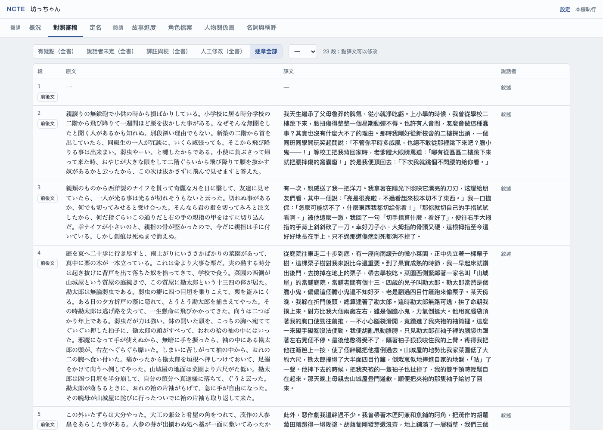
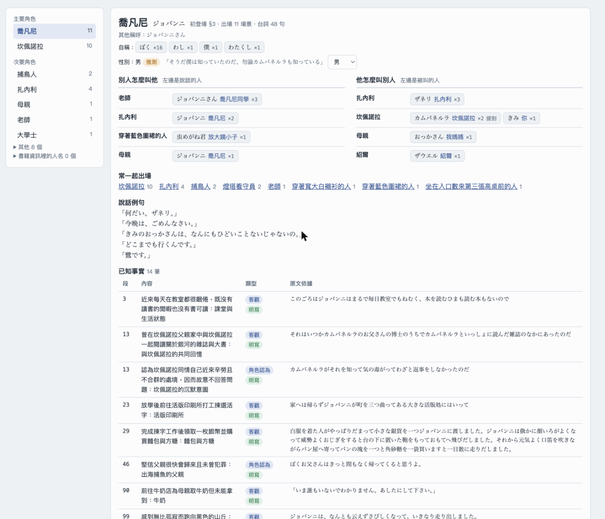
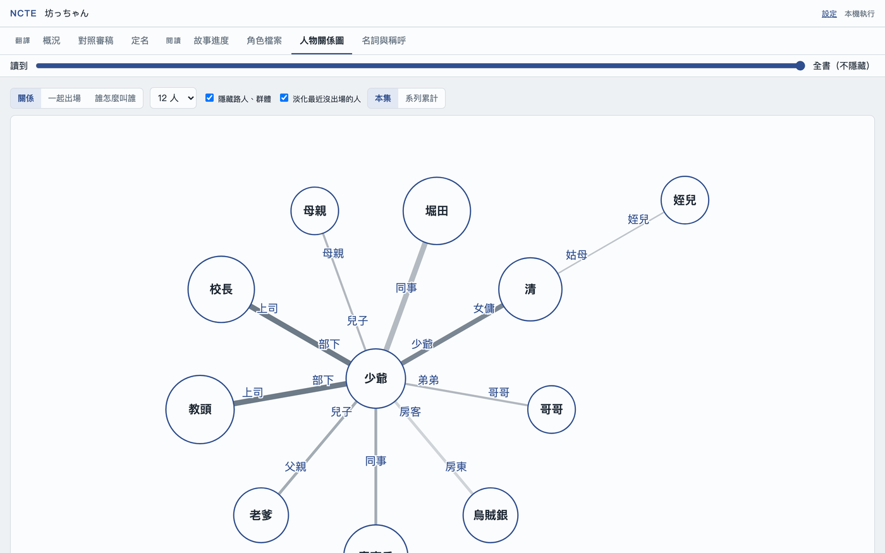
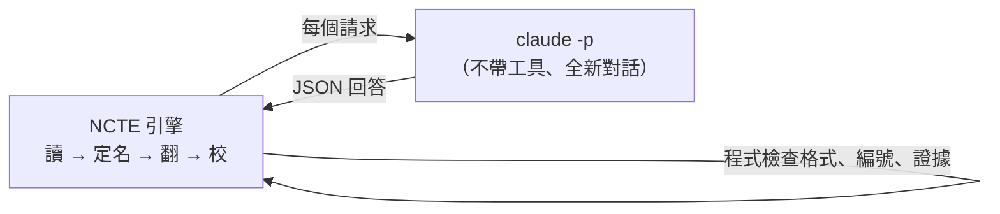

# NCTE — Novel Context Translation Engine

把**有權使用、無 DRM** 的日文 EPUB 小說（主要是輕小說）翻成臺灣繁體中文，輸出一般閱讀器能開的完整 EPUB。在自己的 Mac 上執行（網頁介面或指令），資料都存在本機。

模型有兩種用法：
- **Claude 方案（建議、預設）**：用你自己的 Claude 訂閱（電腦上裝好並登入 Claude Code），不需要金鑰，NCTE 不另外收費。
- **OpenRouter**：沒有 Claude 訂閱時，用 OpenRouter 上的模型（預設 Gemini），需要金鑰並儲值，依用量付費。

## 它怎麼翻：先像譯者一樣讀完，再動筆
一般的機器翻譯一次只看一小段，所以常常搞錯「這句是誰說的」「這個角色是男是女」「敘述是不是主角自己在講」。日文又常省略主語，前後文一斷就容易翻錯。NCTE 模仿譯者的做法：**先把整本讀完、做筆記，翻譯時帶著筆記翻**。


1. **匯入、切場景**：安全檢查後切成段落，依目錄分章；每一章由模型讀過後決定場景從哪裡換。
2. **讀全書**：一個場景一個場景讀，記下誰在說話、對誰說、角色與性別、誰怎麼叫誰、敘述人稱、人物關係、劇情事實，都要附原文證據。模型是譯者，負責讀和判斷；程式是它的筆記本，負責記錄、核對證據確實在原文裡、控制「讀到哪裡知道什麼」。
3. **覆核**：模型自己標出沒把握的判斷、證據核對不過的判斷、只有稱呼沒有名字的人物（「姊姊」是不是某位已知角色）、群體的成員，帶前後文再看一次；接著歸納人物關係、整理書中反覆出現的術語在這本書裡的意思（附原文證據；翻譯與校稿遇到這個詞時附上）、決定譯名。
4. **翻譯**：一個場景一個請求，只附「讀到這裡為止」已知的資訊，不劇透。
5. **檢查、審稿**：程式檢查殘留假名、簡體字、你／妳等，模型確認後修正；翻完後逐段對照原文校稿，再像只讀中文的讀者讀一次，卡住的地方改寫或加譯註。每個修正都會再對照原文驗收一次：沒確認修好的不算修好，留給你看。
6. **匯出**：重建 EPUB，用 EPUBCheck 驗證，並列出「可驗收」還缺什麼（見下方〈匯出不等於完成〉）。

- **證據**：模型的判斷都要附原文證據，程式會檢查；推測的不會被當成確定的事。第一人稱的敘述者怎麼稱呼自己，讀的時候決定、全書固定。
- **不劇透**：翻到第 3 章時，只會用到第 3 章以前揭露的資訊。身分揭曉前，角色只以當時的稱呼出現。
- **少打擾**：名字、稱呼的譯法由模型決定、程式檢查，不會停下來問；有疑點的地方自動交給審稿處理。想改譯名可以翻完再改，已翻好的段落會一起換掉。
- **時間與費用**（一本輕小說約 11–14 萬字，2026-10-18～19 整本實測）：
  - Claude 方案：實際工作時間約 1.6 小時（3,689 段，同時 2 個請求；撞到額度上限時會停下來等重置，另計），不另收費，照定價約 US$43。這次沒有量用掉多少額度百分比。
  - OpenRouter（Gemini）：約 3 小時、US$9 左右。開始前會顯示「約多少、最多多少」，預算上限依「最多」的金額自動設定。
  - Claude 方案的數字出自 2026-10-19 用現行 `claude` 來源、預設設定（Sonnet 讀、Opus 翻與檢查；修正驗收、對照校稿、人物關係、覆核用 high）的整本實測，見 changelog〈整本實測：新的 claude 來源〉。那次中途撞到額度上限、等了約 4 小時才重置，從開始到結束約 5.6 小時。

## 畫面
以下截圖都是青空文庫的公共領域作品（夏目漱石『坊っちゃん』前兩章）。

**對照審稿**：原文、譯文、說話者並排；有疑點的台詞標出程式與模型的意見。點譯文可以直接修改。


**角色檔案**：角色的其他稱呼、自稱、性別與依據，誰怎麼叫他、他怎麼叫別人，以及已知事實與人物關係；引用的原文都附上該段譯文，方便對照。


**人物關係圖**：由讀的時候記下的關係、事實與原文歸納，每條都附依據。人物位置依全書固定，拖動「讀到」滑桿只會增減人物與關係；實線是身分（親屬、師生、婚約）、虛線是情感（好友、愛慕），新出現或改變的關係會標出，同一個人的不同身分（分身、秘密身分、不同時期的自己）用雙線連起來（推測的用虛線）；標籤會自動避開人物與其他標籤；點兩人之間的線，可看關係的變化（附原文與譯文）。


## 測試結果
> 下表都是 2026-10-17 審查（[`docs/audit-2026-10-17.md`](docs/audit-2026-10-17.md)）之前跑的：當時審稿後的修正只經程式檢查、沒有對照原文驗收。數字是與正式中文版的逐句對照與人工抽查，**不是**人工標註的語義正確率；「高品質譯本」目前還沒有足夠證據，待驗證的項目見審查報告第五節。

**輕小說**（版權作品，只寫類型與數字；與正式中文版對照的，是同一段落逐句比對）

| 類型 | 考驗的地方 | 結果 |
|---|---|---|
| 奇幻戀愛（轉生、第三人稱，約 3,700 段） | 女性角色的你／妳、第三人稱敘述、人物關係 | 整本 US$4.3、約 1 小時 40 分（改版前 US$6.2、約 2.5 小時）；整理好的 18 對人物關係全部找到；「某人的兩個跟班」這類群體，讀的時候就判斷成員，關係照群體的身分寫成「主從」。與正式中文版對照，你／妳誤用從早期的 19 句降到 0–3 句（新流程整本約 3 句，3,563 段中）；第三人稱敘述誤寫成「我」，1,200 段抽驗從 9 處降到 0，視角人物換人的場景也判斷正確 |
| 奇幻（第一人稱、主角一開始沒有名字） | 第一人稱敘述、敬稱 | 抽驗 382 段 US$0.68：每個場景都判斷為第一人稱，主角取名前不亂指定名字；先前 894 段抽驗你／妳 0 差異 |
| 奇幻美食 | 料理名、魔物名定名 | 抽驗 648 段 US$1.15：你／妳 1 處差異（性別未明的角色） |
| 近未來科幻（直播、遊戲，約 3,200 段） | 虛擬世界與現實的雙重身分、大量直播台詞 | 整本 US$4.8、約 1 小時 50 分：說話者未定的台詞從舊流程 123 句降到 97 句（約 6.5%），讀者檢查改了 15 處；虛擬世界的歌姬和女主角在揭曉處標成「同一人」；需要從對話推一層的關係（兄長與同居的人）在整理關係時從原文推出。EPUBCheck 剩下的錯誤都是原書本身的寫法 |
| 校園日常（兩位敘事者、系列第 1、2 集） | 換敘事者、系列角色延續、雙關 | 第 2 集抽驗 474 段：第 1 集的角色直接沿用；被內容過濾擋下的段落改成分段讀，0 段漏讀；店名的雙關由讀者檢查補上譯註 |

**公共領域作品**（青空文庫，抽驗前段，四本共 US$2.30）

| 作品 | 考驗的地方 | 結果 |
|---|---|---|
| 宮沢賢治『銀河鉄道の夜』（200 段） | 第三人稱、片假名人名 | 視角人物判斷正確；角色的內心話（原文就是「僕」）譯成「我」不再被誤標 |
| 夏目漱石『坊っちゃん』（2 章） | 第一人稱、大量綽號 | 綽號都整理成角色別名，綽號與本名是同一人的會合併；讀者檢查改掉「男主角脫掉洋裝」（應為西裝），看不懂的綽號加了譯註 |
| 夏目漱石『吾輩は猫である』（30 段） | 以貓為敘述者的特殊自稱 | 自稱原本「我」「吾輩」混用，改成讀的階段決定、全書固定後 17 段一致；主人的日記仍用「我」 |
| 夢野久作『ドグラ・マグラ』（150 段） | 第一人稱、失憶的敘述者 | 人稱判斷正確 |

**整本比較**（2026-10-18～19，奇幻戀愛那本整本約 3,600 段，同一套流程只換模型；細節見 [`docs/changelog.md`](docs/changelog.md) 與 ADR-062）

| 模型 | 時間 | 費用 | 你／妳與正式中文版不同 | 由 Opus 依同一套標準重新校稿，留下影響理解的錯 |
|---|---|---|---|---|
| **Claude 方案（新 `claude` 來源，Sonnet 讀、Opus 翻與檢查、校稿 high、併發 2）（預設）** | 約 1.6 小時 | 不另收費（照定價 US$43） | 未比對 | 重校 high 6 處／兩可 2 |
| Claude 方案（ncte-agent drive）：Sonnet 讀、Opus 翻與檢查 | 約 6 小時 | 不另收費（照定價約 US$39） | 2 句 | 2 處 |
| Claude：全部 Opus | 約 6.5 小時 | 不另收費（照定價約 US$60） | 3 句 | 4 處 |
| Claude：全部 Sonnet | 約 6 小時 | 不另收費（照定價約 US$38） | 5 句 | 28 處（意思讀錯、口吻與敬語效果不見、性別稱呼） |
| OpenRouter：Gemini（`gemini-3.8-flash`） | 約 3 小時 | US$9.10 | 4 句 | 未用同一方法測（逐段對照官方的結果見 changelog） |

第一列是現行 `claude` 來源的整本實測（2026-10-19；時間是實際工作時間，不含等額度重置）。下面三列 Claude 出自 ncte-agent 的 drive：每步的推理程度沒有傳給 `claude -p`，對照校稿與修正驗收不是 high，重校用 medium 與較舊的校稿提示詞（見 changelog 2026-10-19 節）。所以第一列和下面三列的重校數字不能直接比：第一列用 high 與新的提示詞（多了褒貶與語氣的規則），同一份譯文用 medium 重校是 8 處，而 high 與 medium 兩輪只重疊 4 處——單輪重校本身的差異就有三四處。你／妳是同一段落和正式中文版逐句比對；其中幾句四個版本都一樣、只和官方不同（前後文本身有兩種讀法）。全部 Sonnet 雖然單價低，初稿錯得多、校稿後逐段重譯，花費反而和預設組合差不多。

**現行流程的抽樣**（2026-10-18，OpenRouter／Gemini，三本各前 300 段，與正式中文版逐段對照；細節見 [`docs/changelog.md`](docs/changelog.md)）

| 類型 | 考驗的地方 | 結果 |
|---|---|---|
| 奇幻（轉生成非人生物、第一人稱，心靈對話多） | 無發話句的台詞、你／妳的時機 | US$0.60：你／妳在角色性別寫明之後才用；與官方對照意思大致一致，有幾處比官方準確，也有幾處不如（改口被抹平、詞義偏差） |
| 奇幻戀愛（轉生、第三人稱） | 有發話句的台詞、老人口吻、陷阱句（句中寫出名字的是聽話的人） | US$0.71：說話者人工抽看全對；品質與官方相當，少數褒貶或敬語語氣的偏差 |
| 奇幻美食 | 古風口吻的女神、說話者證據核對 | US$0.71：模型給錯發話句（寫的是聽話的人）時程式正確降為推測 |

兩種讀法都說得通的句子，不同模型會各選一邊，對照校稿也可能把一種改成另一種；這類句子目前沒有特別處理。對照校稿用較高的推理後抓到的錯變多，但每次仍會漏掉一些，以褒貶、語氣類最難抓。

**要注意**：名著很可能被模型讀過。『ドグラ・マグラ』的書名被譯成通行的中文書名，但原文沒有任何解釋，這是模型本來就知道的。所以名著截圖只用來展示功能，翻譯品質以輕小說的數字為準。正式的人工標註評測（`ncte eval run`）還沒有跑。

## 不用指令的用法（網頁介面）
1. 安裝 [Python 3.12 以上](https://www.python.org/downloads/)，下載本專案資料夾。
2. 在 Finder 雙擊 **`NCTE.command`**（第一次會自動安裝，約幾分鐘；macOS 若擋下，請按右鍵 →「打開」）。瀏覽器會打開 NCTE。
3. 右上角「設定」確認連線方式：
   - **Claude 方案**（預設）：顯示「找到 Claude Code」就可以開始；找不到的話先安裝 [Claude Code](https://docs.claude.com/en/docs/claude-code)，在終端機執行 `claude` 登入。
   - **OpenRouter**：「連線方式」改選 OpenRouter，貼上 [OpenRouter](https://openrouter.ai/keys) 金鑰並儲值。開始前會顯示估價（約多少、最多多少，每個步驟都算進去）；預算上限依「最多」的金額自動設定（只擋異常），到了會先停下來問你。

   書庫頁把 EPUB 拖進去 → 選系列 → 書的概況頁按「開始翻譯」。
   - 先讀完整本再翻：讀的階段（約占費用一半）還看不到譯文。名字與稱呼的譯法由模型決定、程式檢查，不會停下來問；想改的話翻完後到「定名」頁改，已翻好的段落會一起換掉。
   - 可以暫停；關掉視窗也不會遺失進度，下次按「繼續」接著做。
4. 翻完在概況頁按「匯出 EPUB」→「下載」。「對照審稿」可以逐段修改譯文。

模型與推理程度不用選（推理一般 medium；做判斷的步驟——對照校稿、人物關係、覆核、修正驗收——用 high）：
- Claude 方案：讀書的步驟（切場景、讀場景、記憶整理、角色印象、體例）用 Sonnet，翻譯、術語定義、定名、覆核、人物關係、規則確認、審稿、對照校稿、讀者檢查與修正驗收用 Opus（比較見上方〈整本比較〉）。若把翻譯改成 Sonnet，翻譯也用 high：小樣本測試裡 Sonnet 在 medium 會看到後文的線索卻沒用上，high 才譯對（設定檔自己寫了 `translate` 的推理程度就照你寫的）。
- OpenRouter：`google/gemini-3.8-flash`。同一章節的比較裡，更便宜的模型會忽略角色性別（你／妳）、或整批改寫成簡體（[`docs/changelog.md`](docs/changelog.md)）。

### Claude 方案怎麼運作
NCTE 的每個請求都是一次全新的 `claude -p`（Claude Code 的非互動模式）：步驟的提示詞取代 Claude Code 自己的系統提示，不帶工具、不讀你的 Claude Code 設定、不留對話紀錄。用你的訂閱額度，NCTE 不另外收費；畫面上的金額是照定價換算的參考，不會向你收費。額度用完會自動等到重置再接著翻（每次等待前在畫面或指令列寫一行原因）；沒登入、或 Claude Code 不接受送去的指令（例如版本太舊）會立刻停下來告訴你。指令列在命令前加 `NCTE_LLM_PROVIDER=claude`（預設就是），改回 API 用 `NCTE_LLM_PROVIDER=openrouter`。



**讓 agent 自己回答（進階）**：`ncte agent start 書.epub -w 工作區`，之後由對話中的 agent 逐題 `ncte agent next` → 回答 → `ncte agent submit`（每題有說明檔與輸出格式）；或安裝選用套件 `pip install -e '.[agent]'` 後 `claude mcp add ncte -- ncte mcp`，用 MCP 工具做同樣的事。Claude Code 的 skill 在 [`skills/ncte-translate`](skills/ncte-translate/SKILL.md)（複製或連結到 `~/.claude/skills/`）。一般翻書用上面的 Claude 方案即可，agent 逐題回答會多花很多額度。

> 開發狀態與測試紀錄：[`docs/changelog.md`](docs/changelog.md)　決策：[`docs/decisions.md`](docs/decisions.md)　架構：[`docs/architecture.md`](docs/architecture.md)

## 隱私與權利（請先讀）
- 翻譯時（包括從網頁介面開始的翻譯），**所需的原文段落與上下文會送到模型供應商**：Claude 方案經 Claude Code 送到 Anthropic，適用你的 Claude 帳號的資料設定；OpenRouter 則由 OpenRouter 路由給第三方模型供應商（例如 Google），各供應商的資料保留／訓練政策不同，請在 OpenRouter 帳號的 Privacy 設定中確認。「本機模型」來源（實驗）則完全在這台電腦上跑，原文不會送出去；品質與速度看你的電腦與模型，目前還比不上 Claude 方案或 Gemini。
- 只處理你有權使用的無 DRM EPUB。翻譯輸出不代表你取得再散布或公開分享的權利。
- 原始 EPUB、資料庫、匯出檔都在 `./workspace/`（已列入 `.gitignore`）。API Key 不會寫入 log、報告或錯誤訊息。

## 安裝（macOS，全新環境）
```bash
cd ncte
python3 -m venv .venv            # Python 3.12+
source .venv/bin/activate
pip install -e '.[dev]'
ncte --version
pytest                            # 全部離線測試，不需要 API Key
```

### EPUBCheck（建議，選用）
```bash
brew install openjdk              # 或任何 Java 17+
mkdir -p workspace/tools && cd workspace/tools
curl -LO https://github.com/w3c/epubcheck/releases/download/v5.4.0/epubcheck-5.4.0.zip
unzip epubcheck-5.4.0.zip && cd ../..
```
NCTE 會自動尋找 PATH 上的 `epubcheck`、`EPUBCHECK_JAR` 環境變數或 `workspace/tools/**/epubcheck.jar`；也可在設定檔指定 `export.epubcheck_path`。找不到時只做內部檢查，並標示「尚未經 EPUBCheck 驗證」。

### Claude 方案（預設）
安裝 [Claude Code](https://docs.claude.com/en/docs/claude-code)，在終端機執行一次 `claude` 登入你的 Claude 帳號即可，不需要金鑰。

### 本機模型（實驗）
```bash
export NCTE_LLM_PROVIDER=local             # 或網頁「設定 → 連線方式 → 本機模型」
lms server start                            # LM Studio：先下載並載入一個模型；或用 llama-server / mlx_lm.server
ncte models                                 # 列出伺服器上的模型；預設用已載入的那個（local/default）
```
原文不離開這台電腦、不收費；但一本書要好幾個小時，而且目前測過的本機模型在人稱、說話者判斷上都還比不上 Claude 方案或 Gemini（見 `docs/decisions.md` ADR-068）。伺服器位址可在設定檔的 `openrouter.local_base_url` 改；要讓部分步驟用 Claude 方案，`stage_models` 可以指到 `claude/sonnet`。

### OpenRouter 金鑰（不用 Claude 方案時）
```bash
export NCTE_LLM_PROVIDER=openrouter        # 或寫進 .env；網頁「設定 → 連線方式」也能切換
export OPENROUTER_API_KEY=sk-or-v1-...     # 或 cp .env.example .env 後填入
```
`import`、`inspect`、`validate`、`report`、`status`、`--dry-run` 都不需要金鑰。

也可以透過 fal 使用 OpenRouter 模型，保留原有直連方式：

```yaml
openrouter:
  provider: fal  # 預設 claude；模型等其他設定沿用
```

將 `FAL_KEY=你的金鑰` 放進專案根目錄的 `.env`（不要提交或貼到對話中）。
網頁「設定」也能切換連線方式、分別儲存兩種金鑰；切換選擇以
`NCTE_LLM_PROVIDER=fal` / `openrouter` 保存於 `.env`，其優先權高於 YAML，
環境變數又高於 `.env`。執行中的任務需先暫停；續譯沿用任務建立時的連線設定。
不會在兩種連線間自動切換，也不需要新增 Python 套件。

fal 使用官方 OpenAI 相容入口 `https://fal.run/openrouter/router/openai/v1`，
模型與參考價格仍查 OpenRouter 公開 `/models`，不會把 fal 金鑰送到 OpenRouter。
模型目錄不保證該模型在 fal 的即時可用性；估價參考 OpenRouter，回應有 `usage.cost`
時記錄回報費用，沒有時保留估算標記，最終帳單以 fal 為準。fal 路徑目前不提供餘額查詢
及 `/generation` 費用補查；歷史費用校準按連線方式分開。結構化輸出與 reasoning
參數沿用現有請求及本地 Pydantic 驗證，真實模型相容性仍須用金鑰小量驗證。


## 使用流程
```bash
# 1. 匯入並檢查（不呼叫 LLM）
ncte import  ./samples/book.epub
ncte inspect ./samples/book.epub          # 結構、單元數、會保留原文的單元

# 2. 翻譯（Claude 方案：先讀再翻，不收費、不設預算）
ncte translate ./samples/book.epub --mode context

# 2'. 改用 OpenRouter：確認模型與當下費率（公開 /models API，價格不寫死）→ 試算 → 正式翻譯（預算上限，超過即停止，可續跑）
export NCTE_LLM_PROVIDER=openrouter
ncte models --refresh --filter gemini
ncte translate ./samples/book.epub --mode context --dry-run
ncte translate ./samples/book.epub --mode context --model google/gemini-3.8-flash --budget-usd 12

# 5. 進度、續譯（Ctrl+C 可安全中斷）
ncte status ./samples/book.epub
ncte resume --run-id <run-id>                    # 可加 --budget-usd 10 提高上限

# 6. 匯出、驗證、報告
ncte export   ./samples/book.epub --lang zh-TW   # → workspace/exports/book.zh-TW.epub（另印一行「acceptance」）
ncte validate ./workspace/exports/book.zh-TW.epub --original ./samples/book.epub
ncte report --run-id <run-id> --format html      # → workspace/reports/<book>/run-<id>.html
ncte report --run-id <run-id> --reconcile        # 以 /generation 回填最終費用

# 7. 只重翻部分單元（其他譯文不受影響）
ncte retranslate ./samples/book.epub --unit-id u_xxxxxxxx --budget-usd 0.5
#   --model / --reasoning-effort low|medium|high|default 可用來比較模型（default＝模型自己的預設）
```

### 系列書（多集共用角色、譯名、劇情記憶）
```bash
ncte import 第1集.epub --series "作品名" --volume 1
ncte import 第3集.epub --series "作品名" --volume 3 --label 第3集   # 可以先翻後面的集數
ncte series list
ncte series set-volume 外傳.epub 2.5                               # 調整閱讀順序
ncte import 第4集.epub --series auto                              # 套用自動偵測的系列與集數
```
匯入時會從 EPUB 3 系列欄位（`belongs-to-collection`）、Calibre 欄位（`calibre:series`）、書名（「〇〇 2」「〇〇（3）」「第4巻」「Ⅱ」「上／下」…）偵測系列與集數並提示，但**不會自動加入**（放錯系列會混到角色與譯名）；確認後用 `--series auto` 或 `ncte series move` 加入。`ncte inspect` 也會顯示偵測結果。
每個系列一個資料夾（`workspace/series/<作品名>/`）。第 N 集看得到前面集數的記憶；較早的集數（即使較晚才翻）看不到後面集數才揭露的內容，但會沿用已決定的譯名。

### 稱呼與實體卡（正式名稱、全名、暱稱、通稱…）
```bash
ncte names list 書.epub                     # 每個人物／團體的所有稱呼與譯名、警告
ncte names link 書.epub ソラっち --to ソラ --type nickname --zh 小索拉
ncte names link 書.epub ミナちゃん --to ミナ妹 --shared   # 兩個人共用的稱呼（不合併，翻譯時依上下文判斷）
ncte names address 書.epub --character ミナ                   # 誰怎麼稱呼誰（含敬稱、譯法、使用次數、首次出現）
ncte names address-set 書.epub --speaker ソラ --to ミナ --ja ミナっち --zh 小米娜
ncte names gender 書.epub                    # 角色性別（原文明寫／推測／人工）與依據；翻譯時決定「你／妳」「他／她」
ncte names gender 書.epub ミナ female      # 人工設定（unknown＝不提供，翻譯用「你」）
ncte names gender-scan 書.epub               # 已讀過的舊書補記性別（只呼叫記憶更新，不動其他記憶）
ncte names relations 書.epub                # 已讀過的舊書補做人物關係（由事實歸納，ADR-039）
```

### 系列翻譯風格（每一集都適用）
```bash
ncte style show 書.epub
ncte style set 書.epub --honorifics omit --rule "先輩一律譯「學姊」" --voice "ミナ=話少、句子短、常結巴"
```
敬稱處理有 `natural`（預設，依語氣自然處理）、`explicit`（固定譯出）、`omit`（原則省略）。譯註預設開啟（`--notes off` 關閉）：雙關或文化梗無法用譯文傳達時，匯出的段落後會加「（註：……）」，可用 `ncte notes list` 檢視、`ncte notes drop` 刪除。設定只影響之後的翻譯；既有譯文要重翻才會套用。

### 有上下文的翻譯（劇情記憶、說話者分析）
```bash
ncte translate ./samples/book.epub --mode context --dry-run
ncte translate ./samples/book.epub --mode context --budget-usd 5
ncte scenes     ./samples/book.epub                 # 場景切分；--split/--merge UNIT 手動調整
ncte characters ./samples/book.epub                 # 角色、譯名、口癖統計（只來自已驗證例句）
ncte speakers   ./samples/book.epub --status unknown
ncte speaker-set ./samples/book.epub --utterance-id q_xxx --character c_xxx   # 或 --unknown
ncte memory     ./samples/book.epub --facts --at u_xxx                        # 只看該位置之前已揭露的記憶
ncte memory     ./samples/book.epub --search 銀の鍵
```

**先讀再翻**（預設）：先依目錄分章，每一章請模型決定場景切點（ADR-057）；接著 context 模式會把整集依序讀完（說話者、角色、性別、稱呼、事實、摘要），把有爭議的判斷帶著前後文再覆核一次（ADR-033，沒有爭議時不發請求），再請模型為名字與稱呼提出譯法（含其他選項與理由），最後才逐場景翻譯。重要且有不同譯法的項目（例如主要角色名、常用稱呼、中文只剩一個字的人名）列為「可再確認」；預設不暫停（`context.naming = "auto"`，ADR-035），設為 `"review"` 時會先停下來等你決定：
```bash
ncte names proposals 書.epub                 # 待確認的譯法與選項
ncte names decide 書.epub --id 3 --pick 2    # 選第 2 個選項；或 --zh 自訂譯法；或 --accept-all 全部採用建議
ncte resume --run-id r_xxx                   # 決定後繼續翻譯
ncte names propose 書.epub                   # 已分析過的書（例如要重翻前）單獨產生提案
ncte names proposals 書.epub --all --context   # 所有提案（含已套用的）與原文例句
```
`"off"` 則完全不做定名；`context.read_first = false` 恢復逐場景交錯的舊流程。你決定的譯法在同系列之後的集數會沿用，不會再問。待確認的項目會附上幾句原文例句方便判斷。封面、目次、注意事項、後記、版權頁照常翻譯，但不做角色與劇情分析（`context.skip_book_matter`）。翻譯時仍只附上該場景之前已揭露的資訊（例如身分揭露前，角色只以當時的稱呼出現）。

### 本機網頁介面
```bash
ncte gui            # 開啟 http://127.0.0.1:8780/ （只有這台電腦能開；Ctrl+C 結束）；或雙擊 NCTE.command
```
上傳 EPUB、開始／暫停／繼續翻譯（各階段進度與花費）、匯出與下載、連線方式（Claude 方案或 OpenRouter 金鑰與餘額）；對照審稿（點譯文直接修改、刪除譯註；每段可展開前後各 3 段；標出模型沒把握或證據核對不過的台詞與覆核結果）、定名（看例句選譯法；同一暱稱已定的譯法）、故事進度、角色檔案（性別與依據，可修改）、人物關係圖（拖動「讀到」滑桿防劇透）、名詞與稱呼。網頁開始的翻譯固定用預設模型；OpenRouter 的預算依估價自動設定（ADR-034），Claude 方案不設預算（ADR-062）。

### 品質控制與人工校正
```bash
ncte glossary set    ./samples/book.epub ミナ 米娜 --category character   # 列出受影響單元；只有這些會重翻
ncte glossary impact ./samples/book.epub ミナ
ncte unit ./samples/book.epub u_xxx                  # 原文、placeholder、所有譯文版本、QA 發現
ncte edit ./samples/book.epub --unit-id u_xxx --text "還有，明天⟦1⟧一定⟦/1⟧要早點來。」"
ncte review ./samples/book.epub --scope flagged --budget-usd 0.5
ncte proofread ./samples/book.epub                   # 逐段對照原文校稿，真正的錯誤交回翻譯（ADR-051）
ncte proofread ./samples/book.epub --passes 2        # 校兩輪：第二輪在第一輪修完後再校整本（ADR-066）
ncte reader-check ./samples/book.epub                # 以不懂日文的讀者身分讀中文，看不懂的地方對照原文修正或加註（ADR-038）
ncte names terms ./samples/book.epub                 # 已讀過的書：整理術語在這本書裡的意思（ADR-069）
ncte glossary define ./samples/book.epub 詞 "意思"     # 自己寫某個術語在這本書裡的意思（模型不會覆蓋）
```
校稿預設一輪；一輪大約只抓到一半，同一個模型再校一次會抓到另一批，所以可以設 `context.proofread_passes: 2`（最多 3，或指令加 `--passes`）讓它在修完後再校整本，代價是每多一輪約多一次校稿的額度（ADR-066）。

自動複查由設定 `review.automatic_review: off | flagged_only | all` 控制（預設只複查被程式 QA 或說話者衝突標記的單元，最多一輪）。審稿看前後各 5 段與每句說話者。

**修正要對照原文驗收（ADR-055）**：審稿、對照校稿、讀者檢查提出的問題交回翻譯時，會附上現行譯文，只改有問題的地方；改完再把原文、修改前後與原本的問題交給模型判斷一次（關於原文意思的問題只告訴它類別、不給找錯者的理由，讓它自己讀原文）：
- 修好了：結案，採用新譯文。
- 原譯文本來就說得通（指出的不是錯，或兩種讀法都成立）：結案，維持原譯文。
- 還是錯、無法判斷、檢查失敗：問題保留，新譯文標為「待審」（`needs_review`），留給你決定。
- 修改帶出新的錯：不採用，書裡維持原譯文。
- 人工改過的譯文不會被機器修正蓋掉。

被內容過濾擋下、或請求失敗的段落不算審過，原本的疑點不會被清掉。因此「待審」可能比以前多，那是過去被當成已修好的部分。設定 `review.fix_check: false` 可以省下這一步，但修正一律記為「未驗證」，不會算成修好。

規則改進後可用 `ncte recheck 書.epub` 重新檢查既有譯文（不呼叫 API，也不會把還有未結問題的段落改成通過），再用 `ncte review 書.epub` 修正被標記的段落。

### 匯出不等於完成
匯出永遠可以做（沒翻好的段落保留日文）。`ncte export` 另外列出「可驗收」的檢查（報告 JSON 的 `acceptance`）：應翻段落都有譯文、沒有待審段落、沒有開著的嚴重問題、每個修正都對照原文驗收過、沒有被擋或失敗的段落、對照校稿與讀者檢查跑完整本、人工修改仍在、EPUB 驗證通過。全部通過只表示流程每一步都做完、沒有靜默失敗，**不代表譯文品質合格**。

### A/B 評測
```bash
ncte eval check
ncte eval run --dry-run
ncte eval run --experiments A,B,C,D --repeat 2 --budget-usd 0.5     # → workspace/eval/<時間>/report.html
```
說明見 [`docs/evaluation.md`](docs/evaluation.md)。
全域選項：`-w/--workspace DIR`、`-c/--config FILE`（預設自動讀 `./ncte.yaml`；範例見 `config.example.yaml`）。

### 真實 smoke test
Claude 方案直接執行下面的指令即可（不收費，用少量額度）；OpenRouter 先 `export NCTE_LLM_PROVIDER=openrouter`（需要金鑰、會產生少量費用）。
```bash
python scripts/make_sample_epub.py
ncte translate tests/fixtures/basic.epub --dry-run                 # 先看估價（約 US$0.02–0.03）
ncte translate tests/fixtures/basic.epub --limit-units 5 --budget-usd 0.05
ncte report --book tests/fixtures/basic.epub --format json --reconcile
ncte export tests/fixtures/basic.epub
```
`--fake` 會改用離線 FakeLLM：**輸出不是翻譯**，只用來驗證流程。

## 運作方式（摘要）
（context 模式另外：先依序讀完整集——每個場景做說話者／角色分析並以程式驗證、以逐字證據整理記憶——再決定名字與稱呼的譯法，最後逐場景翻譯，翻譯時只帶入「該場景之前已揭露」的記憶（人物卡、說話者、稱呼、敘述視角都用當時已知的名字），並對被標記的單元做一次複查；翻完後對照原文校稿、讀者檢查，每個修正都再對照原文驗收。詳見 [`docs/architecture.md`](docs/architecture.md)。）

1. **安全匯入**：拒絕 Zip Slip、Zip Bomb、XXE、DRM 加密、fixed-layout；經 `container.xml` 找 OPF。
2. **翻譯單元**：段落／標題等葉節點；行內 `<em>`、`<a>`、`<br/>`、外字圖等轉成 `⟦n⟧` placeholder；ruby 轉成 `漢字《かな》` 作為提示。模型永遠看不到 HTML。
3. **翻譯**：context 模式一個場景一個請求（整段對話一起看；超過 6,000 字的場景在敘述段落之間切開，每一部分都看得到整個場景）；baseline 模式依章節分批（約 1400 日文字）。附前後文與術語表；`response_format` JSON Schema（strict）；嚴格驗證 unit_id 一一對應、placeholder 完整、程式 QA。失敗：重試 → 對半切批 → 保留原文並列入報告。
4. **成本**：每次請求記錄 tokens、`usage.cost`、generation id、延遲、重試；送出前預算預檢；中斷時尚未回應的請求記為「帳單未知」並計入估計。
5. **重建**：只替換已驗證的文字節點；圖片、CSS、字型 byte-for-byte 保留；`mimetype` 置首不壓縮；匯出後自動驗證（內部檢查＋EPUBCheck）。

## 已知限制
- 真實模型的 A/B 評測與人工標註的語義評測尚未執行；現行流程整本實測只有一本（四種模型組合），另有三本各 300 段的抽樣。其他出版社的 EPUB 格式可能遇到新的狀況。
- Claude 方案會用到訂閱的額度（一本實際工作約 1.6 小時）；5 小時額度用完時翻譯會停下來等重置（可能等好幾個小時），不會中斷。`--dry-run` 在這個方案下估出的金額是 0（不收費），不代表用量。
- 內容審查：雲端模型可能誤擋正常段落（例如未成年角色加上可疑大人的情境）。翻譯被擋時先拿掉記憶資料、再切小重送；讀被擋時把場景對半切重讀。仍被擋的段落保留原文或只用程式分析，並列入報告。
- Gemini 等推理模型的推理 token 以輸出價計費（翻譯的輸出約一半是推理），推理量難以事先知道。試算涵蓋每個步驟：有過去實際花費的步驟依最近的執行校正（一般值與最貴的一次再加餘裕），沒有的依抽樣中的占比估，標為未校正。
- 更便宜的模型目前不建議：第二章比較中 claude-haiku-5.5 忽略角色卡的性別（你／妳錯 36 句），deepseek-v4-flash、qwen3.8-flash 會整批改寫成簡體（現在會被程式擋下重翻，但多花費用）。
- context 模式依場景順序執行（為了讓記憶依序更新），不使用併發；baseline 可併發。先讀再翻時，第一段譯文要等整集讀完（約占總費用四成）才會出現；預算若在讀的階段用完，不會有任何譯文。
- 說話者由模型判斷（ADR-059）。模型說「原文寫明」時要給出發話句的原文，程式只核對位置與名字：那幾個字要在這句台詞所在段落的敘述、或緊鄰的純敘述段落裡，而且寫出說話者的名字（第一人稱場景含敘述者的自稱）；核對不過就保留模型的答案、標為推測並交給覆核。程式不解析日文文法。
- 「這句話對誰說」是模型的判斷，分明確與推測（ADR-060）；推測的只在本段上下文也支持時才決定你／妳。
- 同一角色的不同稱呼只在有原文證據（或人工連結）時才合併；名字揭曉時的合併只在揭曉位置之後可見（ADR-032），被覆核質疑的合併會列為待確認，不會自動拆開。
- 網頁介面同時只翻一本書；翻譯中關掉 NCTE 會在下次「繼續」時從最後完成的請求接著做（中斷的那個請求可能已計費）。
- 人工譯文永遠優先；目前沒有「撤銷人工譯文」指令，需再以 `ncte edit` 覆寫。
- 不支援 fixed-layout、DRM、段落內 SVG/MathML、複雜 ruby（這些單元保留原文並列在報告中）。
- 譯本不輸出 ruby；讀音只作為翻譯提示。
- `dc:identifier` 保持原值，部分閱讀器可能把譯本與原書視為同一本。
- 預算檢查以保守估計進行；併發時可能有一個批次量級的偏差（報告中顯示上限）。

## 專案結構
```
src/ncte/  cli.py cli_memory.py cli_agent.py config.py library.py workspace.py series.py lexicon.py exporter.py samples.py
  epub/        security parser units reassemble validate matter series_meta
  llm/         base claude_cli openrouter fal_openrouter fake schemas prompt_loader short_ids cost
  agent/       tasks client runner mcp_server（agent 逐題回答：`ncte agent …`、`ncte mcp`）
  translation/ orchestrator context_pipeline translator context_builder review rename edits cache dryrun
  analysis/    scene scene_windows split_read dialogue speaker narration reference_resolution memory_update verify
               relations impressions house_style terms naming proofread reader
  memory/      db repository retrieval visibility entities address style terms
  gui/         server data actions manage runner static/
  qa/          rules recheck second_person typeset
  reports/     cost_report qa_report html_report codex acceptance
  eval/        dataset metrics runner data/ncte_eval_v1.json
prompts/<task>/v1.md   版本化 prompt（scenes / scene_windows / scene_analyze / memory_update / verify / relations / impressions / house_style / terms /
                       naming / translate / confirm / review / fix_check / proofread / reader）；修改後下一次執行生效（`ncte gui` 要重開），
                       同一主版本內修改不會讓舊譯文失效
NCTE.command           Finder 雙擊啟動網頁介面
skills/ncte-translate/ Claude Code 的 skill（複製或連結到 ~/.claude/skills/）
tests/                 unit / integration / eval（全部離線）
scripts/make_sample_epub.py   產生自製測試 EPUB
```

## 開發里程碑
| Milestone | 狀態 |
|---|---|
| M0 骨架、設定、SQLite、FakeLLM、測試 | ✅ |
| M1 EPUB 安全解析與原樣重建（EPUBCheck 驗證） | ✅ |
| M2 Baseline 翻譯（OpenRouter、成本、預算、斷點續譯） | ✅ 離線測試通過；已用一本真實輕小說（約 3,300 段）完整實測 |
| M3 場景、角色及劇情記憶（`--mode context`、防劇透、FTS5） | ✅ 離線測試通過 |
| M4 說話者序列分析、口癖、人工確認 | ✅ 離線測試通過 |
| M5 選擇性複查、人工校正、報告 | ✅ 離線測試通過 |
| M6 A/B 評測（人工標註集、CSV/HTML 報告） | ✅ 流程可執行；真實模型的評測數據尚未產生 |

之後新增：系列書（多集共用記憶、跨集防劇透）、實體卡（正式名稱／愛稱／通稱）、名詞索引、人物關係圖、敘述人稱、讀者檢查、全書對照校稿、全書體例、修正對照原文驗收與可驗收報告、Claude 方案（訂閱當模型）與 agent 逐題回答（MCP、skill）。
