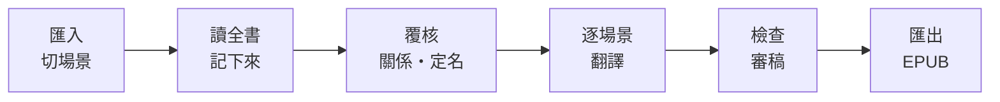
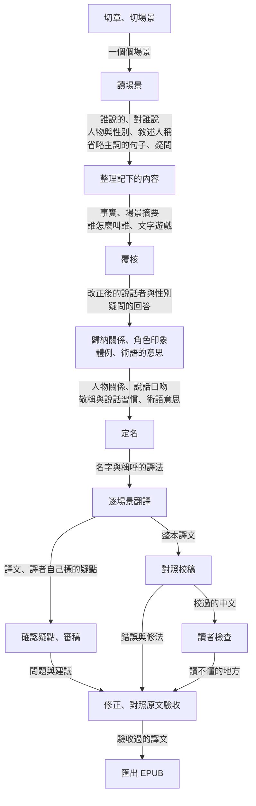
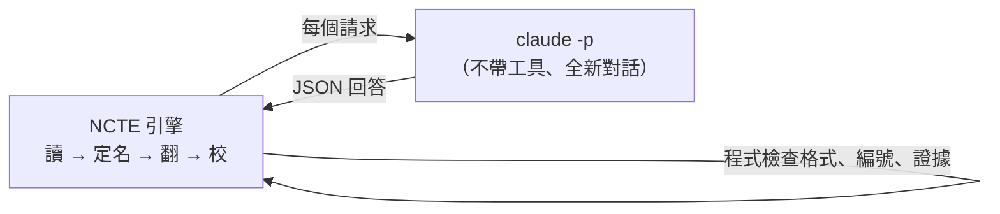

# NCTE — Novel Context Translation Engine

NCTE 把日文 EPUB 小說翻成臺灣繁體中文，主要是輕小說。

- **能翻的書**：你有權使用、**沒有 DRM** 的日文 EPUB。
- **輸出**：一般閱讀器能開的完整 EPUB。
- **在哪裡執行**：你自己的 Mac。用網頁介面或指令操作。
- **資料**：都存在這台電腦。

## 連線方式
「連線方式」是 NCTE 怎麼找到模型。網頁「設定」裡的欄位也叫這個名字。可以選下面幾種：

| 連線方式 | 要準備什麼 | 費用 |
|---|---|---|
| **Claude 方案**（建議、預設） | 你自己的 Claude 訂閱。電腦上裝好並登入 Claude Code。不需要金鑰 | NCTE 不另外收費 |
| **ChatGPT 方案（Codex，實驗）** | 你已有的 ChatGPT 訂閱 | 用訂閱的額度，NCTE 不另外收費 |
| **Gemini API**（Google AI Studio 金鑰） | Google AI Studio 金鑰。NCTE 直接連 Google 的 Gemini | Google 依用量向你收費。開始前 NCTE 會估價、設預算上限 |
| **OpenRouter** | 沒有訂閱時用。要金鑰並儲值。預設模型是 Gemini | 依用量付費 |
| **本機模型（實驗）** | 原文不離開電腦 | 目前品質還比不上上面幾種 |

「方案」指你自己的訂閱。「額度」指訂閱在一段時間內能用的量，用完要等重置。

> **不再提供 Google Antigravity（`agy`）**
> - 原因：Google 的 [Antigravity 常見問題](https://antigravity.google/docs/faq/)說明，無頭模式 `agy -p` 只能用在你自己的腳本與 CI。把 agy 包在第三方程式或應用程式裡，消費者方案不支援，可能導致帳號停權。第三方工具應改用 Google AI Studio 或 Gemini Enterprise 的 API 金鑰。
> - 2026-10-16 [開發者論壇](https://discuss.ai.google.dev/t/clarification-on-consumer-plan-policy-for-invoking-official-agy-via-local-subprocess/189905)上的回覆也說，以這份常見問題為準。回覆者未標示身分。
> - NCTE 就是這樣的應用程式。所以 NCTE 拿掉了 agy，改成直接連 Gemini API。
> - 如果設定還選著 agy，NCTE 會在送出任何請求之前停下來，並說明原因。請改選 Gemini API 或其他連線方式。

## 它怎麼翻：先像譯者一樣讀完，再動筆
一般的機器翻譯一次只看一小段。所以它常常搞錯三件事：這句是誰說的、這個角色是男是女、敘述是不是主角自己在講。日文又常省略主詞，前後文一斷就容易翻錯。

NCTE 模仿譯者的做法：**先把整本讀完，把讀到的事記下來，翻譯時帶著記下的內容翻**。



1. **匯入、切場景**：NCTE 先做安全檢查，再切成段落，依目錄分章。模型讀過每一章，決定場景從哪裡換。
2. **讀全書**：模型一個場景一個場景讀，把讀到的事記下來。記下的內容包括這些，每一項都附原文證據：
   - 誰在說話、對誰說；
   - 角色與性別、誰怎麼叫誰；
   - 敘述人稱、人物關係、劇情事實。

   分工是：模型是譯者，負責讀和判斷。程式是它的筆記本，負責三件事：記錄、核對證據確實在原文裡、控制「讀到哪裡知道什麼」。
3. **覆核**：「覆核」是模型帶前後文，把下面這些判斷再看一次：
   - 模型自己標出沒把握的判斷；
   - 證據核對不過的判斷；
   - 只有稱呼、沒有名字的人物（例如「姊姊」是不是某位已知角色）；
   - 兩張人物卡被用了同一個名字或描述時，是不是同一人；
   - 群體的成員；
   - 讀的時候順手推測的事，例如轉述的話原本是誰說的。這類推測會單獨再問一次。NCTE 不先告訴模型原本的答案，讓它重新從原文找證據。

   覆核之後，模型做三件事：
   - 歸納人物關係。如果原文寫明是父親還是母親那邊、哥哥還是弟弟，關係裡也寫明，翻譯照著選詞。如果沒寫明，就用不選邊的說法。
   - 整理術語：書中反覆出現的詞在這本書裡的意思，附原文證據。翻譯與對照校稿遇到這個詞時，會附上這個意思。
   - 定名：決定譯名。「譯名」是名字與稱呼的中文譯法。
4. **翻譯**：一個場景一個請求。請求只附「讀到這裡為止」已知的資訊，所以不劇透。
5. **檢查、審稿**：
   - 程式檢查殘留假名、簡體字、你／妳等問題。模型確認後修正。
   - **對照校稿**：翻完後，模型逐段對照原文檢查譯文。它同時潤稿：意思沒錯、但中文讀起來卡住的地方，在不改意思的前提下改順。
   - **讀者檢查**：模型再像只讀中文的讀者讀一次。卡住的地方改寫，或加譯註。
   - **修正驗收**：每個修正都會再對照原文檢查一次。沒確認修好的不算修好，留給你看。
6. **匯出**：NCTE 重建 EPUB，用 EPUBCheck 驗證。它也列出「可驗收」還缺什麼（見下方〈匯出不等於完成〉）。

另外三個原則：
- **證據**：模型的判斷都要附原文證據，程式會檢查。推測的事不會被當成確定的事。第一人稱的敘述者怎麼稱呼自己，在讀的時候決定，全書固定。
- **不劇透**：翻到第 3 章時，只會用到第 3 章以前揭露的資訊。身分揭曉前，角色只以當時的稱呼出現。
- **少打擾**：譯名由模型決定、程式檢查，NCTE 不會停下來問你。有疑點的地方自動交給審稿處理。如果想改譯名，可以翻完再改。已翻好的段落會一起換掉。

### 時間與費用
一本輕小說約 11–14 萬字。下表是 2026-10-18～19 的整本實測。

| 連線方式 | 時間 | 費用 |
|---|---|---|
| Claude 方案 | 實際工作時間約 1.6 小時（3,689 段，同時 2 個請求）。撞到額度上限時會停下來等重置，等待時間另計 | 不另收費。照定價約 US$43。這次沒有量用掉多少額度百分比 |
| OpenRouter（Gemini） | 約 3 小時 | US$9 左右 |
| Gemini API | 還沒有實測過，時間還沒有數字 | 還沒有數字 |

- OpenRouter：開始前會顯示「約多少、最多多少」。預算上限依「最多」的金額自動設定。
- Gemini API：和 OpenRouter 用的是同一個 Gemini 模型。估價與預算的做法和 OpenRouter 相同。
- Claude 方案的數字出自 2026-10-19 的整本實測。那次用現行的 `claude` 連線方式和預設設定：Sonnet 讀，Opus 翻與檢查；修正驗收、對照校稿、人物關係、覆核的推理程度用 high。見 changelog〈整本實測：新的 claude 來源〉。
- 那次中途撞到額度上限，等了約 4 小時才重置。從開始到結束約 5.6 小時。

## 每一步交給下一步的東西
每一步都只把「讀到這裡為止」該知道的交下去。名字、事實、關係都帶著它在書裡第一次出現的位置。後面的步驟依位置取用，所以不會劇透。



| 步驟 | 做什麼 | 交給下一步什麼 |
|---|---|---|
| 切章、切場景 | 依目錄分章。模型在每章裡決定場景從哪裡換 | 一個個場景 |
| 讀場景 | 一場一場讀。記下誰說的、對誰說，人物、性別、敘述人稱，主詞省略時是誰做的，以及沒把握的疑問 | 誰對誰說、人物資料、疑問 |
| 整理記下的內容 | 從同一場整理出事實、摘要、誰怎麼叫誰、文中寫明的關係、文字遊戲。每筆都附原文證據 | 事實、摘要、稱呼、文字遊戲 |
| 覆核 | 把沒把握的判斷帶前後文再看一次 | 改正後的說話者與性別、疑問的回答 |
| 歸納 | 看完全書，再整理四件事：人物關係、主要角色的口吻、全書的敬稱與說話習慣（體例）、反覆出現的術語在這本書裡的意思 | 關係、口吻、體例、術語意思 |
| 定名 | 決定名字與稱呼的中文 | 譯名 |
| 翻譯 | 一個場景一個請求，帶著到這裡為止記下的內容 | 譯文、譯者自己標的疑點 |
| 確認、審稿 | 程式和譯者標出疑點。模型帶前後文確認後審稿 | 要修的問題 |
| 對照校稿 | 逐段對照原文（Claude 方案做兩輪） | 錯誤與修法；意思對但讀起來卡住的地方的改寫（潤稿） |
| 讀者檢查 | 只讀中文，找讀者會卡住的地方 | 讀不懂的地方 |
| 修正、驗收 | 帶著問題重譯，再對照原文看是否真的修好。沒確認的不算修好 | 驗收過的譯文 |
| 匯出 | 重建 EPUB 並驗證 | 完成的書與報告 |

不是每一步都拿到全部記下的內容。例如讀者檢查只看中文；規則確認只拿判斷那條規則需要的資料。每一步實際拿到哪些資料、取到書的哪個位置、各有多少名額，見 [`docs/architecture.md`〈各階段傳遞了什麼〉](docs/architecture.md#各階段傳遞了什麼)。

## 畫面
以下截圖都是青空文庫的公共領域作品（夏目漱石『坊っちゃん』前兩章）。

**對照審稿**：這一頁並排顯示原文、譯文、說話者。有疑點的台詞會標出程式與模型的意見。點譯文可以直接修改。


**角色檔案**：這一頁顯示角色的其他稱呼、自稱、性別與依據。它也顯示誰怎麼叫他、他怎麼叫別人，以及已知事實與人物關係。引用的原文都附上該段譯文，方便對照。


**人物關係圖**：關係圖由讀的時候記下的關係、事實與原文歸納。每條關係都附依據。
- 人物位置依全書固定。拖動「讀到」滑桿，只會增減人物與關係。
- 實線是身分（親屬、師生、婚約）。虛線是情感（好友、愛慕）。
- 新出現或改變的關係會標出。
- 同一個人的不同身分（分身、秘密身分、不同時期的自己）用雙線連起來。推測的用虛線。
- 標籤會自動避開人物與其他標籤。
- 點兩人之間的線，可以看關係的變化（附原文與譯文）。


## 測試結果
> 下面「輕小說」與「公共領域作品」兩個表，都是 2026-10-17 審查（[`docs/audit-2026-10-17.md`](docs/audit-2026-10-17.md)）之前跑的。當時審稿後的修正只經程式檢查，沒有做修正驗收。
> - 數字來自與正式中文版的逐句對照與人工抽查，**不是**人工標註的語義正確率。
> - 「高品質譯本」目前還沒有足夠證據。待驗證的項目見審查報告第五節。

**輕小說**（版權作品，只寫類型與數字。與正式中文版對照時，是同一段落逐句比對）

| 類型 | 考驗的地方 | 結果 |
|---|---|---|
| 奇幻戀愛（轉生、第三人稱，約 3,700 段） | 女性角色的你／妳、第三人稱敘述、人物關係 | 整本 US$4.3、約 1 小時 40 分（改版前 US$6.2、約 2.5 小時）。整理好的 18 對人物關係全部找到。「某人的兩個跟班」這類群體，讀的時候就判斷成員，關係照群體的身分寫成「主從」。與正式中文版對照，你／妳誤用從早期的 19 句降到 0–3 句（新流程整本約 3 句，3,563 段中）。第三人稱敘述誤寫成「我」：1,200 段抽驗從 9 處降到 0。視角人物換人的場景也判斷正確 |
| 奇幻（第一人稱、主角一開始沒有名字） | 第一人稱敘述、敬稱 | 抽驗 382 段，US$0.68。每個場景都判斷為第一人稱。主角取名前，不亂指定名字。先前 894 段抽驗，你／妳 0 差異 |
| 奇幻美食 | 料理名、魔物名定名 | 抽驗 648 段，US$1.15。你／妳 1 處差異（性別未明的角色） |
| 近未來科幻（直播、遊戲，約 3,200 段） | 虛擬世界與現實的雙重身分、大量直播台詞 | 整本 US$4.8、約 1 小時 50 分。說話者未定的台詞從舊流程 123 句降到 97 句（約 6.5%）。讀者檢查改了 15 處。虛擬世界的歌姬和女主角，在揭曉處標成「同一人」。需要從對話推一層的關係（兄長與同居的人），在整理關係時從原文推出。EPUBCheck 剩下的錯誤都是原書本身的寫法 |
| 校園日常（兩位敘事者、系列第 1、2 集） | 換敘事者、系列角色延續、雙關 | 第 2 集抽驗 474 段。第 1 集的角色直接沿用。被內容過濾擋下的段落改成分段讀，0 段漏讀。店名的雙關由讀者檢查補上譯註 |

**公共領域作品**（青空文庫，抽驗前段，四本共 US$2.30）

| 作品 | 考驗的地方 | 結果 |
|---|---|---|
| 宮沢賢治『銀河鉄道の夜』（200 段） | 第三人稱、片假名人名 | 視角人物判斷正確。角色的內心話（原文就是「僕」）譯成「我」，不再被誤標 |
| 夏目漱石『坊っちゃん』（2 章） | 第一人稱、大量綽號 | 綽號都整理成角色別名。綽號與本名是同一人的會合併。讀者檢查改掉「男主角脫掉洋裝」（應為西裝），看不懂的綽號加了譯註 |
| 夏目漱石『吾輩は猫である』（30 段） | 以貓為敘述者的特殊自稱 | 自稱原本「我」「吾輩」混用。改成讀的階段決定、全書固定後，17 段一致。主人的日記仍用「我」 |
| 夢野久作『ドグラ・マグラ』（150 段） | 第一人稱、失憶的敘述者 | 人稱判斷正確 |

**（歷史紀錄）Antigravity 連線方式整本**（這個連線方式已停用，見最上方的說明。結果留作 Gemini Flash 的參考）
- 範圍：2026-10-21～22，近未來科幻那本，約 3,300 段，所有步驟用 Gemini Flash。
- 時間與額度：約 14 小時、782 個請求，用掉 Google 每週額度約 47%。最慢的是兩輪對照校稿（高推理，約 5 小時 20 分）。
- 盲評：和 10/16 用 OpenRouter 翻的舊版比 60 段。評審看前後各五段原文，以及兩版各自的前後文。結果：新版較好 9、舊版較好 15、相同 36。判為意思錯的：新版 0、舊版 2。新版輸的多是用詞。
- 說書人口吻的旁白，新版讀對了。
- 有一句轉述的話（「被說了……」），讀書時記錯了說的人。後來 NCTE 加了「推測的事單獨再問」。正常流程重跑那一場，就改對了（ADR-093）。

**整本比較**（2026-10-18～19，奇幻戀愛那本，整本約 3,600 段。同一套流程，只換模型。細節見 [`docs/changelog.md`](docs/changelog.md) 與 ADR-062）

「重校」是測試用的步驟：由 Opus 依同一套標準再做一次對照校稿，數出留下的、影響理解的錯。

| 模型 | 時間 | 費用 | 你／妳與正式中文版不同 | 重校後留下影響理解的錯 |
|---|---|---|---|---|
| **Claude 方案（新的 `claude` 連線方式，Sonnet 讀、Opus 翻與檢查、對照校稿 high、併發 2）（預設）** | 約 1.6 小時 | 不另收費（照定價 US$43） | 未比對 | 重校 high 6 處／兩可 2 |
| Claude 方案（ncte-agent drive）：Sonnet 讀、Opus 翻與檢查 | 約 6 小時 | 不另收費（照定價約 US$39） | 2 句 | 2 處 |
| Claude：全部 Opus | 約 6.5 小時 | 不另收費（照定價約 US$60） | 3 句 | 4 處 |
| Claude：全部 Sonnet | 約 6 小時 | 不另收費（照定價約 US$38） | 5 句 | 28 處（意思讀錯、口吻與敬語效果不見、性別稱呼） |
| OpenRouter：Gemini（`gemini-3.8-flash`） | 約 3 小時 | US$9.10 | 4 句 | 未用同一方法測（逐段對照正式中文版的結果見 changelog） |

怎麼讀這個表：
- 第一列是現行 `claude` 連線方式的整本實測（2026-10-19）。時間是實際工作時間，不含等額度重置。
- 下面三列 Claude 出自 ncte-agent 的 drive。那時每步的推理程度沒有傳給 `claude -p`，對照校稿與修正驗收不是 high。重校用 medium 與較舊的對照校稿提示詞（見 changelog 2026-10-19 節）。
- 所以第一列和下面三列的重校數字不能直接比。第一列用 high 與新的提示詞（多了褒貶與語氣的規則）。同一份譯文用 medium 重校是 8 處。high 與 medium 兩輪只重疊 4 處：單輪重校本身的差異就有三四處。
- 你／妳是同一段落和正式中文版逐句比對。其中幾句四個版本都一樣、只和正式中文版不同，因為前後文本身有兩種讀法。
- 全部 Sonnet 雖然單價低，但初稿錯得多，對照校稿後要逐段重譯。所以花費反而和預設組合差不多。

**現行流程的抽樣**（2026-10-18，OpenRouter／Gemini，三本各前 300 段，與正式中文版逐段對照。細節見 [`docs/changelog.md`](docs/changelog.md)）

| 類型 | 考驗的地方 | 結果 |
|---|---|---|
| 奇幻（轉生成非人生物、第一人稱，心靈對話多） | 無發話句的台詞、你／妳的時機 | US$0.60。你／妳在角色性別寫明之後才用。與正式中文版對照，意思大致一致。有幾處比正式中文版準確，也有幾處不如（改口被抹平、詞義偏差） |
| 奇幻戀愛（轉生、第三人稱） | 有發話句的台詞、老人口吻、陷阱句（句中寫出名字的是聽話的人） | US$0.71。說話者人工抽查全對。品質與正式中文版相當，少數褒貶或敬語語氣有偏差 |
| 奇幻美食 | 古風口吻的女神、說話者證據核對 | US$0.71。模型給錯發話句（寫的是聽話的人）時，程式正確降為推測 |

還沒解決的兩件事：
- 兩種讀法都說得通的句子，不同模型會各選一邊。對照校稿也可能把一種改成另一種。這類句子目前沒有特別處理。
- 對照校稿用較高的推理後，抓到的錯變多。但每次仍會漏掉一些，以褒貶、語氣類最難抓。

**要注意**：名著很可能被模型讀過。例如『ドグラ・マグラ』的書名被譯成通行的中文書名，但原文沒有任何解釋，這是模型本來就知道的。所以名著截圖只用來展示功能，翻譯品質以輕小說的數字為準。正式的人工標註評測（`ncte eval run`）還沒有跑。

## 不用指令的用法（網頁介面）
1. 安裝 [Python 3.12 以上](https://www.python.org/downloads/)。
2. 下載本專案資料夾。
3. 在 Finder 雙擊 **`NCTE.command`**。第一次會自動安裝，約幾分鐘。
   - 如果 macOS 擋下，請按右鍵 →「打開」。

   結果：瀏覽器打開 NCTE。
4. 按右上角「設定」，確認連線方式：
   - **Claude 方案**（預設）：如果顯示「找到 Claude Code」，就可以開始。如果找不到，先安裝 [Claude Code](https://docs.claude.com/en/docs/claude-code)，再在終端機執行 `claude` 登入。
   - **Gemini API**：「連線方式」改選「Gemini API（Google AI Studio 金鑰）」。貼上在 [Google AI Studio](https://aistudio.google.com/apikey) 建立的金鑰（做法見下方〈Gemini API〉）。估價與預算上限和 OpenRouter 相同。
   - **OpenRouter**：「連線方式」改選 OpenRouter。貼上 [OpenRouter](https://openrouter.ai/keys) 金鑰，並儲值。開始前會顯示估價：約多少、最多多少，每個步驟都算進去。預算上限依「最多」的金額自動設定，只用來擋異常。花費到上限時，NCTE 會先停下來問你。
5. 在書庫頁，把 EPUB 拖進去。
6. 選系列。
7. 在書的概況頁，按「開始翻譯」。
   - NCTE 先讀完整本再翻。讀的階段約占費用一半，這時還看不到譯文。
   - 譯名由模型決定、程式檢查，NCTE 不會停下來問你。如果想改，翻完後到「定名」頁改。已翻好的段落會一起換掉。
   - 你可以暫停。關掉視窗也不會遺失進度。下次按「繼續」，接著做。
8. 翻完後，在概況頁按「匯出 EPUB」。
9. 按「下載」。

如果要逐段修改譯文，用「對照審稿」頁。

### 預設模型
模型與推理程度不用選。推理程度一般用 medium。做判斷的步驟用 high：對照校稿、人物關係、覆核、修正驗收。

| 連線方式 | 預設模型 |
|---|---|
| Claude 方案 | 讀書的步驟（切場景、讀場景、記憶整理、角色印象、體例）用 Sonnet。其他步驟用 Opus：翻譯、術語定義、定名、覆核、人物關係、規則確認、審稿、對照校稿、讀者檢查、修正驗收（比較見上方〈整本比較〉） |
| OpenRouter | `google/gemini-3.8-flash`。同一章節的比較裡，更便宜的模型會忽略角色性別（你／妳），或整批改寫成簡體（[`docs/changelog.md`](docs/changelog.md)） |
| Gemini API | 同一個模型，`gemini/gemini-3.8-flash` |

如果把 Claude 方案的翻譯改成 Sonnet，翻譯也用 high。原因：小樣本測試裡，Sonnet 在 medium 會看到後文的線索卻沒用上，high 才譯對。如果設定檔自己寫了 `translate` 的推理程度，就照你寫的。

### Claude 方案怎麼運作
NCTE 的每個請求都是一次全新的 `claude -p`（Claude Code 的非互動模式）：
- 步驟的提示詞取代 Claude Code 自己的系統提示。
- 不帶工具、不讀你的 Claude Code 設定、不留對話紀錄。

費用與額度：
- 請求用你的訂閱額度，NCTE 不另外收費。
- 畫面上的金額是照定價換算的參考，不會向你收費。
- 額度用完時，NCTE 會自動等到重置，再接著翻。每次等待前，它在畫面或指令列寫一行原因。

會立刻停下來的情況：沒登入，或 Claude Code 不接受送去的指令（例如版本太舊）。NCTE 會告訴你原因。

在指令列，命令前加 `NCTE_LLM_PROVIDER=claude`（預設就是）。要改回 API，用 `NCTE_LLM_PROVIDER=openrouter`。



### Codex（ChatGPT 方案，實驗）
如果你有 ChatGPT 訂閱，也可以用 OpenAI 的 Codex CLI 翻譯：
1. 安裝 Codex。
2. 在終端機執行 `codex login`。
3. 到網頁設定選「Codex（ChatGPT 方案）」。或在命令前加 `NCTE_LLM_PROVIDER=codex`。

要知道的事：
- 每個請求是一次全新的 `codex exec`。它用你的 ChatGPT 訂閱額度，NCTE 不另外收費。
- Codex 不回報定價，所以畫面上不顯示金額。
- Codex 每個請求都會帶上自己的固定說明。關掉能關的之後，每次仍約八千到九千 token。所以它比 Claude 方案吃額度。
- 也可以只把某一步交給 Codex，其餘照 Claude 方案。例如在 `ncte.yaml` 寫 `openrouter: {stage_models: {proofread: codex/gpt-6.1-sol}}`。
- 範例書（41 段）從讀到校完約 7 分鐘、34 個請求，用掉每週額度約 1%。**還沒有整本書實測過。**

### Gemini API（Google AI Studio 金鑰）
這個連線方式直接連 Google 的 Gemini API，不經過 OpenRouter：
1. 到 [Google AI Studio](https://aistudio.google.com/apikey)，用 Google 帳號登入。
2. 建立一把 API 金鑰。
3. 在 AI Studio 為這個專案設定帳單。Google 的說明是：連結帳單帳戶並預付（最少 US$5），之後依用量扣款。是 Google 向你收費，NCTE 不另外收費。
   - 免費方案有用量限制。而且依 Google 的說明，要付費方案，提示與回應才不會被拿去改進 Google 的產品。翻書請用付費方案。
4. 在網頁「設定 → 連線方式」選「Gemini API（Google AI Studio 金鑰）」，貼上金鑰，按儲存。或在指令列執行 `export NCTE_LLM_PROVIDER=gemini`、`export GEMINI_API_KEY=…`（也可以寫進 `.env`）。

費用怎麼算：
- Gemini API 不回報價格。所以 NCTE 用 OpenRouter 公開價目表上同一個 Google 模型（`google/…`）的價格，乘上 Google 回報的 token 數，換算估價和花費。讀取快取的 token 照快取價。
- 實際金額以 Google 的帳單為準。網頁上查不到 Google 帳戶的餘額。
- 如果 OpenRouter 價目表上找不到這個模型，就算不出費用。NCTE 不會用它開始付費的翻譯。
- 和 OpenRouter 一樣，開始前會顯示「約多少、最多多少」。預算上限依「最多」的金額自動設定。花費到上限時，NCTE 會先停下來問你。

這個連線方式還沒有用真的金鑰實測過。

### 交叉校稿（選用，預設關閉）
「交叉校稿」是最後一輪對照校稿改用另一家公司的模型。例如主要用 Claude，最後一輪用 Gemini API 的 Gemini Flash。這樣比較不會和翻譯的模型錯在同一個地方。

預設不開，因為：
- 它會用到另一個方案的額度（Gemini API 則是另外計費）。
- 書的內容也會送到那家公司。

如果要用，在網頁設定裡打開。

### 每本書用了多少額度
Claude 方案與 Codex 的每個請求，都會記下你的方案在各時間窗（5 小時、每週）已經用到幾 %。書的總覽頁（和 `ncte report --book …`）顯示兩項：這本書從第一個請求到最後一個請求用掉了幾 %，以及 token 數。

怎麼讀這個數字：
- 每個人的方案不同，所以顯示的是你自己方案的百分比，不是絕對量。
- 同一時段你在別處用同一個方案，也會算進去。
- 如果中途額度重置，會從 0 重新累加。

### 讓 agent 自己回答（進階）
一般翻書用上面的 Claude 方案即可。agent 逐題回答會多花很多額度。

- 用指令：先執行 `ncte agent start 書.epub -w 工作區`。之後由對話中的 agent 逐題執行 `ncte agent next` → 回答 → `ncte agent submit`。每題有說明檔與輸出格式。
- 用 MCP：安裝選用套件 `pip install -e '.[agent]'`，再執行 `claude mcp add ncte -- ncte mcp`。MCP 工具做同樣的事。
- Claude Code 的 skill 在 [`skills/ncte-translate`](skills/ncte-translate/SKILL.md)。把它複製或連結到 `~/.claude/skills/`。

> 開發狀態與測試紀錄：[`docs/changelog.md`](docs/changelog.md)　決策：[`docs/decisions.md`](docs/decisions.md)　架構：[`docs/architecture.md`](docs/architecture.md)

## 隱私與權利（請先讀）
**原文會送出去。** 翻譯時（包括從網頁介面開始的翻譯），所需的原文段落與上下文會送到模型供應商。各連線方式送到哪裡：

| 連線方式 | 送到哪裡 | 要確認什麼 |
|---|---|---|
| Claude 方案 | 經 Claude Code 送到 Anthropic | 適用你的 Claude 帳號的資料設定 |
| OpenRouter | 由 OpenRouter 路由給第三方模型供應商（例如 Google） | 各供應商的資料保留／訓練政策不同。請在 OpenRouter 帳號的 Privacy 設定中確認 |
| Gemini API | 直接送到 Google | Google 說明免費方案的提示與回應可能用來改進它的產品，付費方案不會（以 Google 的服務條款為準） |
| 本機模型（實驗） | 不送出去。完全在這台電腦上跑 | 品質與速度看你的電腦與模型，目前還比不上 Claude 方案或 Gemini |

**權利**：只處理你有權使用的無 DRM EPUB。翻譯輸出不代表你取得再散布或公開分享的權利。

**本機資料**：原始 EPUB、資料庫、匯出檔都在 `./workspace/`（已列入 `.gitignore`）。金鑰不會寫入 log、報告或錯誤訊息。

## 安裝（macOS，全新環境）
```bash
cd ncte
python3 -m venv .venv            # Python 3.12+
source .venv/bin/activate
pip install -e '.[dev]'
ncte --version
pytest                            # 全部離線測試，不需要 API Key
```

### EPUBCheck（建議，選用）
```bash
brew install openjdk              # 或任何 Java 17+
mkdir -p workspace/tools && cd workspace/tools
curl -LO https://github.com/w3c/epubcheck/releases/download/v5.4.0/epubcheck-5.4.0.zip
unzip epubcheck-5.4.0.zip && cd ../..
```
NCTE 會自動找三個地方：PATH 上的 `epubcheck`、`EPUBCHECK_JAR` 環境變數、`workspace/tools/**/epubcheck.jar`。你也可以在設定檔指定 `export.epubcheck_path`。如果都找不到，NCTE 只做內部檢查，並標示「尚未經 EPUBCheck 驗證」。

### Claude 方案（預設）
1. 安裝 [Claude Code](https://docs.claude.com/en/docs/claude-code)。
2. 在終端機執行一次 `claude`，登入你的 Claude 帳號。

不需要金鑰。

### 本機模型（實驗）
```bash
export NCTE_LLM_PROVIDER=local             # 或網頁「設定 → 連線方式 → 本機模型」
lms server start                            # LM Studio：先下載並載入一個模型；或用 llama-server / mlx_lm.server
ncte models                                 # 列出伺服器上的模型；預設用已載入的那個（local/default）
```
- 好處：原文不離開這台電腦，不收費。
- 限制：一本書要好幾個小時。目前測過的本機模型，在人稱、說話者判斷上都還比不上 Claude 方案或 Gemini（見 `docs/decisions.md` ADR-068）。
- 伺服器位址可以在設定檔的 `openrouter.local_base_url` 改。
- 如果要讓部分步驟用 Claude 方案，把 `stage_models` 指到 `claude/sonnet`。

### Gemini API 金鑰
```bash
export NCTE_LLM_PROVIDER=gemini            # 或寫進 .env；網頁「設定 → 連線方式」也能切換
export GEMINI_API_KEY=...                  # Google AI Studio 建立的金鑰；或寫進 .env
```
- 金鑰只放在這台電腦（環境變數或 `.env`）。
- 送出時，金鑰放在請求標頭，不會寫進紀錄或錯誤訊息。
- 價格查 OpenRouter 公開 `/models`。NCTE 不送任何金鑰給 OpenRouter。

### OpenRouter 金鑰（不用 Claude 方案時）
```bash
export NCTE_LLM_PROVIDER=openrouter        # 或寫進 .env；網頁「設定 → 連線方式」也能切換
export OPENROUTER_API_KEY=sk-or-v1-...     # 或 cp .env.example .env 後填入
```
`import`、`inspect`、`validate`、`report`、`status`、`--dry-run` 都不需要金鑰。

#### 透過 fal 使用 OpenRouter 模型
你也可以透過 fal 使用 OpenRouter 模型。原有的直連方式仍保留。

1. 在設定檔寫：

```yaml
openrouter:
  provider: fal  # 預設 claude；模型等其他設定沿用
```

2. 把 `FAL_KEY=你的金鑰` 放進專案根目錄的 `.env`。

> **注意**：不要提交 `.env`，也不要把金鑰貼到對話中。

切換與優先權：
- 網頁「設定」也能切換連線方式，並分別儲存兩種金鑰。
- 切換的選擇以 `NCTE_LLM_PROVIDER=fal` / `openrouter` 保存在 `.env`。
- 優先權：環境變數高於 `.env`，`.env` 高於 YAML。
- 如果任務正在執行，先暫停再切換。續譯沿用任務建立時的連線設定。
- NCTE 不會在兩種連線間自動切換。不需要新增 Python 套件。

fal 怎麼連、費用怎麼算：
- fal 使用官方 OpenAI 相容入口 `https://fal.run/openrouter/router/openai/v1`。
- 模型與參考價格仍查 OpenRouter 公開 `/models`。NCTE 不會把 fal 金鑰送到 OpenRouter。
- 模型目錄不保證該模型在 fal 的即時可用性。
- 估價參考 OpenRouter。如果回應有 `usage.cost`，就記錄回報的費用；如果沒有，就保留估算標記。最終帳單以 fal 為準。
- fal 路徑目前不提供餘額查詢，也不提供 `/generation` 費用補查。
- 歷史費用校準按連線方式分開。
- 結構化輸出與 reasoning 參數沿用現有請求，以及本地 Pydantic 驗證。真實模型的相容性，仍須用金鑰小量驗證。


## 使用流程
```bash
# 1. 匯入並檢查（不呼叫 LLM）
ncte import  ./samples/book.epub
ncte inspect ./samples/book.epub          # 結構、單元數、會保留原文的單元

# 2. 翻譯（Claude 方案：先讀再翻，不收費、不設預算）
ncte translate ./samples/book.epub --mode context

# 3. 改用 OpenRouter：確認模型與當下費率（公開 /models API，價格不寫死）→ 試算 → 正式翻譯（預算上限，超過即停止，可續跑）
export NCTE_LLM_PROVIDER=openrouter
ncte models --refresh --filter gemini
ncte translate ./samples/book.epub --mode context --dry-run
ncte translate ./samples/book.epub --mode context --model google/gemini-3.8-flash --budget-usd 12

# 4. 進度、續譯（Ctrl+C 可安全中斷）
ncte status ./samples/book.epub
ncte resume --run-id <run-id>                    # 可加 --budget-usd 10 提高上限

# 5. 匯出、驗證、報告
ncte export   ./samples/book.epub --lang zh-TW   # → workspace/exports/book.zh-TW.epub（另印一行「acceptance」）
ncte validate ./workspace/exports/book.zh-TW.epub --original ./samples/book.epub
ncte report --run-id <run-id> --format html      # → workspace/reports/<book>/run-<id>.html
ncte report --run-id <run-id> --reconcile        # 以 /generation 回填最終費用

# 6. 只重翻部分單元（其他譯文不受影響）
ncte retranslate ./samples/book.epub --unit-id u_xxxxxxxx --budget-usd 0.5
#   --model / --reasoning-effort low|medium|high|default 可用來比較模型（default＝模型自己的預設）
```
「單元」是 NCTE 翻譯的最小單位：一個段落或標題。本文說的「段」就是一個單元。

### 系列書（多集共用角色、譯名、劇情記憶）
```bash
ncte import 第1集.epub --series "作品名" --volume 1
ncte import 第3集.epub --series "作品名" --volume 3 --label 第3集   # 可以先翻後面的集數
ncte series list
ncte series set-volume 外傳.epub 2.5                               # 調整閱讀順序
ncte import 第4集.epub --series auto                              # 套用自動偵測的系列與集數
```
**偵測系列**：匯入時，NCTE 從三處偵測系列與集數，並提示你：
- EPUB 3 系列欄位（`belongs-to-collection`）；
- Calibre 欄位（`calibre:series`）；
- 書名（「〇〇 2」「〇〇（3）」「第4巻」「Ⅱ」「上／下」…）。

NCTE **不會自動加入**系列，因為放錯系列會混到角色與譯名。確認後，用 `--series auto` 或 `ncte series move` 加入。`ncte inspect` 也會顯示偵測結果。

**系列記下的內容**：每個系列一個資料夾（`workspace/series/<作品名>/`）。
- 第 N 集看得到前面集數記下的內容。
- 較早的集數（即使較晚才翻）看不到後面集數才揭露的內容，但會沿用已決定的譯名。

### 稱呼與實體卡（正式名稱、全名、暱稱、通稱…）
```bash
ncte names list 書.epub                     # 每個人物／團體的所有稱呼與譯名、警告
ncte names link 書.epub ソラっち --to ソラ --type nickname --zh 小索拉
ncte names link 書.epub ミナちゃん --to ミナ妹 --shared   # 兩個人共用的稱呼（不合併，翻譯時依上下文判斷）
ncte names address 書.epub --character ミナ                   # 誰怎麼稱呼誰（含敬稱、譯法、使用次數、首次出現）
ncte names address-set 書.epub --speaker ソラ --to ミナ --ja ミナっち --zh 小米娜
ncte names gender 書.epub                    # 角色性別（原文明寫／推測／人工）與依據；翻譯時決定「你／妳」「他／她」
ncte names gender 書.epub ミナ female      # 人工設定（unknown＝不提供，翻譯用「你」）
ncte names gender-scan 書.epub               # 已讀過的舊書補記性別（只呼叫記憶更新，不動其他記憶）
ncte names relations 書.epub                # 已讀過的舊書補做人物關係（由事實歸納，ADR-039）
```

### 系列翻譯風格（每一集都適用）
```bash
ncte style show 書.epub
ncte style set 書.epub --honorifics omit --rule "先輩一律譯「學姊」" --voice "ミナ=話少、句子短、常結巴"
```
敬稱處理有三種：

| 設定 | 做法 |
|---|---|
| `natural`（預設） | 依語氣自然處理 |
| `explicit` | 固定譯出 |
| `omit` | 原則省略 |

譯註預設開啟（`--notes off` 關閉）。如果雙關或文化梗無法用譯文傳達，匯出的段落後會加「（註：……）」。用 `ncte notes list` 檢視，用 `ncte notes drop` 刪除。

設定只影響之後的翻譯。既有譯文要重翻，才會套用。

### 有上下文的翻譯（劇情記憶、說話者分析）
```bash
ncte translate ./samples/book.epub --mode context --dry-run
ncte translate ./samples/book.epub --mode context --budget-usd 5
ncte scenes     ./samples/book.epub                 # 場景切分；--split/--merge UNIT 手動調整
ncte characters ./samples/book.epub                 # 角色、譯名、口癖統計（只來自已驗證例句）
ncte speakers   ./samples/book.epub --status unknown
ncte speaker-set ./samples/book.epub --utterance-id q_xxx --character c_xxx   # 或 --unknown
ncte memory     ./samples/book.epub --facts --at u_xxx                        # 只看該位置之前已揭露的記憶
ncte memory     ./samples/book.epub --search 銀の鍵
```
指令與設定裡的「記憶」（memory），就是前面說的「記下的內容」。

**先讀再翻**（預設）依序做五件事：
1. 依目錄分章。每一章請模型決定場景切點（ADR-057）。
2. context 模式把整集依序讀完：說話者、角色、性別、稱呼、事實、摘要。
3. 覆核：把有爭議的判斷帶著前後文再看一次（ADR-033）。沒有爭議時，不發請求。
4. 定名：請模型為名字與稱呼提出譯名，包括其他選項與理由。
5. 逐場景翻譯。

**可再確認的譯名**：重要、而且有不同譯法的項目，列為「可再確認」。例如主要角色名、常用稱呼、中文只剩一個字的人名。
- 預設不暫停（`context.naming = "auto"`，ADR-035）。
- 如果設為 `"review"`，NCTE 會先停下來等你決定：

```bash
ncte names proposals 書.epub                 # 待確認的譯法與選項
ncte names decide 書.epub --id 3 --pick 2    # 選第 2 個選項；或 --zh 自訂譯法；或 --accept-all 全部採用建議
ncte resume --run-id r_xxx                   # 決定後繼續翻譯
ncte names propose 書.epub                   # 已分析過的書（例如要重翻前）單獨產生提案
ncte names proposals 書.epub --all --context   # 所有提案（含已套用的）與原文例句
```
- `"off"` 完全不做定名。
- `context.read_first = false` 恢復逐場景交錯的舊流程。
- 你決定的譯名，同系列之後的集數會沿用，不會再問。
- 待確認的項目會附上幾句原文例句，方便判斷。
- 封面、目次、注意事項、後記、版權頁照常翻譯，但不做角色與劇情分析（`context.skip_book_matter`）。
- 翻譯時仍只附上該場景之前已揭露的資訊。例如身分揭露前，角色只以當時的稱呼出現。

### 本機網頁介面
```bash
ncte gui            # 開啟 http://127.0.0.1:8780/ （只有這台電腦能開；Ctrl+C 結束）；或雙擊 NCTE.command
```
網頁介面能做的事：

| 頁面或功能 | 內容 |
|---|---|
| 翻譯 | 上傳 EPUB；開始／暫停／繼續翻譯（各階段進度與花費）；匯出與下載 |
| 設定 | 連線方式（Claude 方案、ChatGPT 方案、Gemini API 金鑰或 OpenRouter 金鑰與餘額） |
| 對照審稿 | 點譯文直接修改、刪除譯註。每段可展開前後各 3 段。標出模型沒把握或證據核對不過的台詞，以及覆核結果 |
| 定名 | 看例句選譯名；同一暱稱已定的譯名 |
| 角色檔案 | 性別與依據，可修改 |
| 人物關係圖 | 拖動「讀到」滑桿防劇透 |
| 故事進度、名詞與稱呼 | 各有一頁 |

- 網頁開始的翻譯，固定用預設模型。
- OpenRouter 的預算依估價自動設定（ADR-034）。Claude 方案不設預算（ADR-062）。

### 品質控制與人工校正
```bash
ncte glossary set    ./samples/book.epub ミナ 米娜 --category character   # 列出受影響單元；只有這些會重翻
ncte glossary impact ./samples/book.epub ミナ
ncte unit ./samples/book.epub u_xxx                  # 原文、placeholder、所有譯文版本、QA 發現
ncte edit ./samples/book.epub --unit-id u_xxx --text "還有，明天⟦1⟧一定⟦/1⟧要早點來。」"
ncte review ./samples/book.epub --scope flagged --budget-usd 0.5
ncte proofread ./samples/book.epub                   # 逐段對照原文校稿兼潤稿，錯誤與讀起來卡住的地方交回翻譯（ADR-051、074）
ncte proofread ./samples/book.epub --passes 2        # 校兩輪：第二輪在第一輪修完後再校整本（ADR-066）
ncte reader-check ./samples/book.epub                # 以不懂日文的讀者身分讀中文，看不懂的地方對照原文修正或加註（ADR-038）
ncte names terms ./samples/book.epub                 # 已讀過的書：整理術語在這本書裡的意思（ADR-069）
ncte glossary define ./samples/book.epub 詞 "意思"     # 自己寫某個術語在這本書裡的意思（模型不會覆蓋）
```

**對照校稿的輪數**：一輪對照校稿大約只抓到一半。同一個模型再校一次，會抓到另一批。所以預設輪數依連線方式不同：

| 連線方式 | 預設輪數 | 原因 |
|---|---|---|
| Claude 方案 | 兩輪（第二輪在第一輪修完後再校整本） | 多用的是訂閱額度，不另花錢 |
| OpenRouter／fal | 一輪 | 每一輪都要付費 |

要改輪數，設 `context.proofread_passes`（1–3；設定檔寫了就照設定檔），或在指令加 `--passes`（ADR-066）。

**自動審稿**：由設定 `review.automatic_review: off | flagged_only | all` 控制。預設只審被程式 QA 或說話者衝突標記的單元，最多一輪。審稿看前後各 5 段，以及每句的說話者。

**修正驗收（ADR-055）**：審稿、對照校稿、讀者檢查提出的問題，會交回翻譯：
1. 翻譯拿到現行譯文，只改有問題的地方。
2. 改完後，模型拿到原文、修改前後的譯文與原本的問題，再判斷一次。如果問題關於原文意思，模型只拿到問題的類別，拿不到找錯者的理由，要自己讀原文。

判斷的結果：

| 結果 | 處理 |
|---|---|
| 修好了 | 結案，採用新譯文 |
| 原譯文本來就說得通（指出的不是錯，或兩種讀法都成立） | 結案，維持原譯文 |
| 還是錯、無法判斷、檢查失敗 | 問題保留。新譯文標為「待審」（`needs_review`），留給你決定 |
| 修改帶出新的錯 | 不採用。書裡維持原譯文 |

人工改過的譯文，不會被機器修正蓋掉。

- 如果段落被內容過濾擋下，或請求失敗，這段不算審過，原本的疑點不會被清掉。因此「待審」可能比以前多：那是過去被當成已修好的部分。
- 設定 `review.fix_check: false` 可以省下修正驗收。但這樣修正一律記為「未驗證」，不會算成修好。

**規則改進後**：
1. 用 `ncte recheck 書.epub` 重新檢查既有譯文。這個指令不呼叫 API，也不會把還有未結問題的段落改成通過。
2. 用 `ncte review 書.epub` 修正被標記的段落。

### 匯出不等於完成
匯出永遠可以做。沒翻好的段落保留日文。

`ncte export` 另外列出「可驗收」的檢查（報告 JSON 的 `acceptance`）。「可驗收」要下面每一項都通過：
- 應翻段落都有譯文；
- 沒有待審段落；
- 沒有開著的嚴重問題；
- 每個修正都做過修正驗收；
- 沒有被擋或失敗的段落；
- 對照校稿與讀者檢查跑完整本；
- 人工修改仍在；
- EPUB 驗證通過。

全部通過，只表示流程每一步都做完、沒有靜默失敗。**這不代表譯文品質合格。**

### A/B 評測
```bash
ncte eval check
ncte eval run --dry-run
ncte eval run --experiments A,B,C,D --repeat 2 --budget-usd 0.5     # → workspace/eval/<時間>/report.html
```
說明見 [`docs/evaluation.md`](docs/evaluation.md)。
全域選項：`-w/--workspace DIR`、`-c/--config FILE`（預設自動讀 `./ncte.yaml`；範例見 `config.example.yaml`）。

### 真實 smoke test
- Claude 方案：直接執行下面的指令即可。不收費，用少量額度。
- OpenRouter：先執行 `export NCTE_LLM_PROVIDER=openrouter`。需要金鑰，會產生少量費用。

```bash
python scripts/make_sample_epub.py
ncte translate tests/fixtures/basic.epub --dry-run                 # 先看估價（約 US$0.02–0.03）
ncte translate tests/fixtures/basic.epub --limit-units 5 --budget-usd 0.05
ncte report --book tests/fixtures/basic.epub --format json --reconcile
ncte export tests/fixtures/basic.epub
```
> **注意**：`--fake` 會改用離線 FakeLLM。**它的輸出不是翻譯**，只用來驗證流程。

## 運作方式（摘要）
context 模式的順序：
1. 先依序讀完整集。每個場景做說話者／角色分析，並由程式驗證；記下的內容都附逐字證據。
2. 決定名字與稱呼的譯名。
3. 逐場景翻譯。翻譯時只帶入「該場景之前已揭露」的記下內容。人物卡、說話者、稱呼、敘述視角都用當時已知的名字。
4. 對被標記的單元做一次審稿。
5. 翻完後做對照校稿、讀者檢查。每個修正都做修正驗收。

詳見 [`docs/architecture.md`](docs/architecture.md)。

所有模式共通的處理：
1. **安全匯入**：拒絕 Zip Slip、Zip Bomb、XXE、DRM 加密、fixed-layout。經 `container.xml` 找 OPF。
2. **翻譯單元**：單元是段落、標題等葉節點。
   - 行內 `<em>`、`<a>`、`<br/>`、外字圖等轉成 `⟦n⟧` placeholder。
   - ruby 轉成 `漢字《かな》`，作為提示。
   - 模型永遠看不到 HTML。
3. **翻譯**：
   - context 模式一個場景一個請求，整段對話一起看。超過 6,000 字的場景，在敘述段落之間切開；每一部分都看得到整個場景。
   - baseline 模式依章節分批（約 1400 日文字）。
   - 請求附前後文與術語表，用 `response_format` JSON Schema（strict）。
   - 程式嚴格驗證：unit_id 一一對應、placeholder 完整、程式 QA。
   - 如果失敗：重試 → 對半切批 → 保留原文並列入報告。
4. **成本**：
   - 每次請求記錄 tokens、`usage.cost`、generation id、延遲、重試。
   - 送出前做預算預檢。
   - 中斷時，尚未回應的請求記為「帳單未知」，並計入估計。
5. **重建**：
   - 只替換已驗證的文字節點。
   - 圖片、CSS、字型 byte-for-byte 保留。
   - `mimetype` 置首，不壓縮。
   - 匯出後自動驗證（內部檢查＋EPUBCheck）。

## 已知限制
### 測試範圍
- 真實模型的 A/B 評測，與人工標註的語義評測，尚未執行。
- 現行流程的整本實測只有一本（四種模型組合），另有三本各 300 段的抽樣。
- 其他出版社的 EPUB 格式可能遇到新的狀況。
- Gemini API 連線方式還沒有用真的金鑰實測過。請求格式、結構化輸出、推理程度、用量欄位，都照 Google 的 API 文件（2026-10-24 讀）實作，並以離線測試驗證。第一次使用時，建議先拿一小段試（`--limit-units`）。

### 額度與費用
- Claude 方案會用到訂閱的額度（一本實際工作約 1.6 小時）。5 小時額度用完時，翻譯會停下來等重置（可能等好幾個小時），不會中斷。
- 在 Claude 方案下，`--dry-run` 估出的金額是 0（不收費）。這不代表用量。
- Gemini 等推理模型的推理 token 以輸出價計費。翻譯的輸出約一半是推理，推理量難以事先知道。
- 估價涵蓋每個步驟：
  - 有過去實際花費的步驟，依最近的執行校正：一般值與最貴的一次，再加餘裕。
  - 沒有實際花費的步驟，依抽樣中的占比估，標為未校正。
- 更便宜的模型目前不建議。第二章比較中：claude-haiku-5.5 忽略角色卡的性別（你／妳錯 36 句）；deepseek-v4-flash、qwen3.8-flash 會整批改寫成簡體。現在程式會擋下簡體並重翻，但會多花費用。
- 預算檢查以保守估計進行。併發時，可能有一個批次量級的偏差（報告中顯示上限）。

### 訂閱方案的命令列工具
訂閱方案是透過各家的命令列工具呼叫模型。這些工具原本是寫程式用的 agent。NCTE 能把它們「關成單純的模型」的程度不同：

| 工具 | 能關到什麼程度 |
|---|---|
| Claude Code | 可以整個換掉它的系統提示，不帶任何工具，最接近直接呼叫模型。每個請求多約一千 token |
| Codex | 可以換掉內建指示、關掉大部分功能。但每個請求仍帶約八千 token 的固定說明，比較吃額度 |
| Antigravity（`agy`） | 已停用。Google 的 [Antigravity 常見問題](https://antigravity.google/docs/faq/)（2026-10-16 論壇回覆也以此為準）說明：把 agy 包在第三方應用程式裡，消費者方案不支援，可能導致停權。所以 NCTE 不再提供。要用 Gemini，請改用 Gemini API 金鑰 |

### 內容審查
雲端模型可能誤擋正常段落，例如未成年角色加上可疑大人的情境。NCTE 這樣處理：
- 翻譯被擋：先拿掉記下的內容，再切小重送。
- 讀被擋：把場景對半切，重讀。
- 仍被擋的段落：保留原文，或只用程式分析，並列入報告。

### 速度與順序
- context 模式依場景順序執行，不使用併發，因為記下的內容要依序更新。baseline 模式可併發。
- 先讀再翻時，第一段譯文要等整集讀完才會出現。讀的階段約占總費用四成。
- 如果預算在讀的階段用完，不會有任何譯文。
- 網頁介面同時只翻一本書。
- 如果翻譯中關掉 NCTE，下次按「繼續」時，NCTE 從最後完成的請求接著做。中斷的那個請求可能已計費。

### 模型的判斷
- 說話者由模型判斷（ADR-059）。模型說「原文寫明」時，要給出發話句的原文。程式只核對位置與名字：
  - 那幾個字要在這句台詞所在段落的敘述裡，或緊鄰的純敘述段落裡；
  - 而且要寫出說話者的名字（第一人稱場景含敘述者的自稱）。

  核對不過時，NCTE 保留模型的答案，標為推測，並交給覆核。程式不解析日文文法。
- 「這句話對誰說」是模型的判斷，分明確與推測（ADR-060）。推測的，只在本段上下文也支持時，才決定你／妳。
- 同一角色的不同稱呼，只在有原文證據（或人工連結）時才合併。名字揭曉時的合併，只在揭曉位置之後可見（ADR-032）。被覆核質疑的合併會列為待確認，不會自動拆開。
- 先用稱號或描述登場的人物（「英雄」「黑髮的女性」），模型讀到名字後，人物卡改用名字，稱號留作別名（ADR-109）。
- 職業、身分的詞（「侍者」「士兵」）指當下擔任的人。原文看不出是前面那位時，模型另建一張卡，交給覆核確認（ADR-110）。

### 人工譯文
- 人工譯文永遠優先。
- 目前沒有「撤銷人工譯文」指令。如果要改，再用 `ncte edit` 覆寫。

### 格式
- 不支援 fixed-layout、DRM、段落內 SVG/MathML、複雜 ruby。這些單元保留原文，並列在報告中。
- 譯本不輸出 ruby。讀音只作為翻譯提示。
- `dc:identifier` 保持原值。部分閱讀器可能把譯本與原書視為同一本。

## 專案結構
```
src/ncte/  cli.py cli_memory.py cli_agent.py config.py library.py workspace.py series.py lexicon.py exporter.py samples.py
  epub/        security parser units reassemble validate matter series_meta
  llm/         base claude_cli codex_cli gemini openrouter fal_openrouter local routing fake schemas prompt_loader short_ids cost
  agent/       tasks client runner mcp_server（agent 逐題回答：`ncte agent …`、`ncte mcp`）
  translation/ orchestrator context_pipeline translator context_builder review rename edits cache dryrun
  analysis/    scene scene_windows split_read dialogue speaker narration reference_resolution memory_update verify
               relations impressions house_style terms naming proofread reader
  memory/      db repository retrieval visibility entities address style terms
  gui/         server data actions manage runner static/
  qa/          rules recheck second_person typeset
  reports/     cost_report qa_report html_report codex acceptance
  eval/        dataset metrics runner data/ncte_eval_v1.json
prompts/<task>/v1.md   版本化 prompt（scenes / scene_windows / scene_analyze / memory_update / verify / relations / impressions / house_style / terms /
                       naming / translate / confirm / review / fix_check / proofread / reader）；修改後下一次執行生效（`ncte gui` 要重開），
                       同一主版本內修改不會讓舊譯文失效
NCTE.command           Finder 雙擊啟動網頁介面
skills/ncte-translate/ Claude Code 的 skill（複製或連結到 ~/.claude/skills/）
tests/                 unit / integration / eval（全部離線）
scripts/make_sample_epub.py   產生自製測試 EPUB
```

## 開發里程碑
| Milestone | 狀態 |
|---|---|
| M0 骨架、設定、SQLite、FakeLLM、測試 | ✅ |
| M1 EPUB 安全解析與原樣重建（EPUBCheck 驗證） | ✅ |
| M2 Baseline 翻譯（OpenRouter、成本、預算、斷點續譯） | ✅ 離線測試通過；已用一本真實輕小說（約 3,300 段）完整實測 |
| M3 場景、角色及劇情記憶（`--mode context`、防劇透、FTS5） | ✅ 離線測試通過 |
| M4 說話者序列分析、口癖、人工確認 | ✅ 離線測試通過 |
| M5 選擇性複查、人工校正、報告 | ✅ 離線測試通過 |
| M6 A/B 評測（人工標註集、CSV/HTML 報告） | ✅ 流程可執行；真實模型的評測數據尚未產生 |

之後新增的功能：
- 系列書（多集共用記下的內容、跨集防劇透）
- 實體卡（正式名稱／愛稱／通稱）
- 名詞索引
- 人物關係圖
- 敘述人稱
- 讀者檢查
- 全書對照校稿
- 全書體例
- 修正驗收與可驗收報告
- Claude 方案（訂閱當模型）
- agent 逐題回答（MCP、skill）
